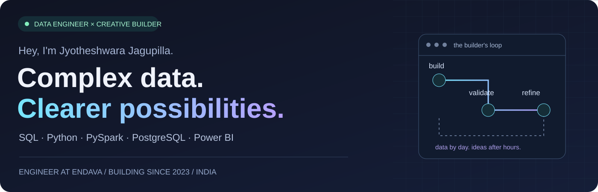
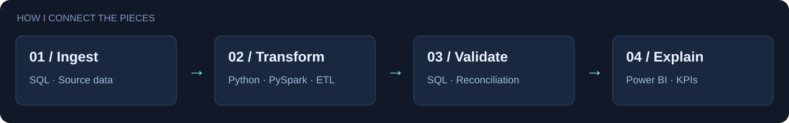
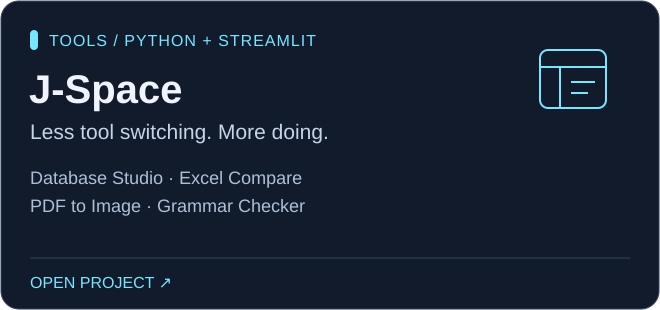
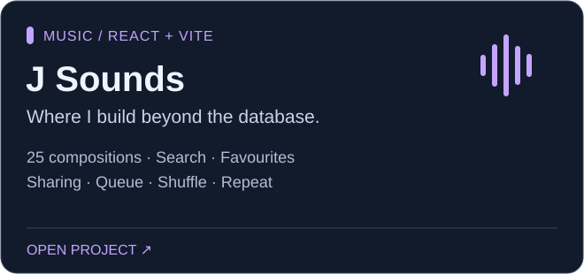
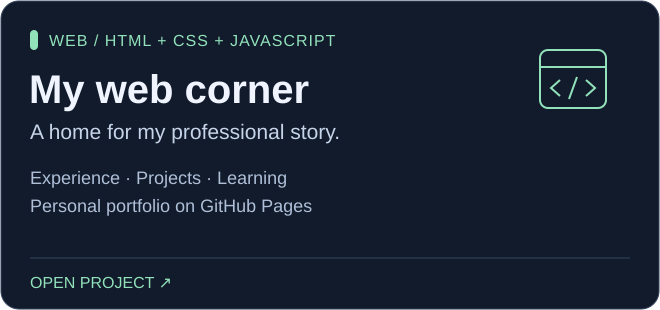

<p align="center"></p>

<p align="center">
  <a href="https://www.linkedin.com/in/jyotheshwara-venkata-sai-kumar-jagupilla-4bb563283/"></a>
  <a href="https://jsounds.pages.dev/"></a>
  <a href="https://github.com/Jyotheshwara?tab=repositories"></a>
</p>

<p align="center"><b>Reliable pipelines. Meaningful analytics. A creative streak.</b><br>I work across <b>Data Engineering & Data Analytics</b> — building Python and PySpark ETL workflows, developing SQL solutions, and turning business questions into Power BI dashboards and insights. After hours, I turn ideas into tools and music experiences.</p>

## 👨‍💻 A little about the builder

```python
class Jyotheshwara:
    role = "Data Engineer | Data Analyst | SQL Developer @ Endava"
    based_in = "Hyderabad, India"
    building_since = 2023

    data_world = ["Healthcare claims", "Python & PySpark ETL",
                  "PostgreSQL", "Migration", "Power BI & DAX"]
    analytics = ["KPI dashboards", "Semantic models", "Data storytelling"]
    creative_world = ["J-Space", "J Sounds", "Web experiences"]
    approach = "Understand → build → validate → refine"
```

<p align="center"></p>

## ⚡ Where I've put it to work

<table>
<tr>
<td width="50%" valign="top">

### 🧬 Healthcare data → dependable workflows

**GxClaims · Python · PySpark · PostgreSQL**

ETL workflows for claims data, transformations and validation — connected to SQL logic supporting claims validation and adjudication analysis.

</td>
<td width="50%" valign="top">

### 🧩 Complex claim structures → configurable design

**GxClaims F6 · PL/pgSQL · JSONB · Python**

Template-driven PostgreSQL database design, D.0 / F6 mapping, adapter workflows, generated columns, indexes, and regression checks.

</td>
</tr>
<tr>
<td width="50%" valign="top">

### 🔄 Different platforms → consistent data

**Oracle / SQL Server → PostgreSQL**<br>**Azure SQL → BigQuery**

Database object conversion, compatibility fixes, schema mapping, source-to-target validation, and ELT pipelines. Experience includes GxClaims and GxDashMaps.

</td>
<td width="50%" valign="top">

### 📊 Business questions → useful analytics

**Data Analytics · Power BI · Power Query · DAX**

Translate business questions into dashboards, KPI scorecards and semantic models. Use Power Query for data preparation and DAX for analytical measures, validate results with SQL, and communicate findings through clear visual reporting. Experience includes SSRS-to-Power BI reporting modernization and deployment across Development, UAT, and Production using Azure DevOps.

</td>
</tr>
</table>

> **Also exploring:** Databricks healthcare analytics POC with Unity Catalog, Delta Lake, and Bronze / Silver / Gold layers; AWS cloud labs and POCs. Snowflake knowledge is foundational.

<sub>Professional experience summaries. Employer code, internal schemas, and client records are not published here.</sub>

## 🎧 After hours, I build differently

<table>
<tr>
<td width="50%"><a href="https://lnkd.in/drVv3GTR"></a></td>
<td width="50%"><a href="https://jsounds.pages.dev/"></a></td>
</tr>
<tr>
<td><b>Build something useful.</b><br>J-Space brings everyday database, spreadsheet, and document tasks into one workspace.<br><a href="https://lnkd.in/drVv3GTR">Open app ↗</a> · <a href="https://github.com/Jyotheshwara/J-Space">Private source</a></td>
<td><b>Build something personal.</b><br>J Sounds brings music, cover art, and interactive web design together.<br><a href="https://jsounds.pages.dev/">Listen ↗</a> · <a href="https://github.com/Jyotheshwara/Jstudios">Private source</a></td>
</tr>
</table>

<details>
<summary><b>🌐 My third project: the existing web portfolio</b></summary>
<br>
<a href="https://jyotheshwara.github.io/"></a>

[Visit portfolio](https://jyotheshwara.github.io/) · [Public HTML/CSS/JavaScript source](https://github.com/Jyotheshwara/Jyotheshwara.github.io)

</details>

<sub>J-Space and Jstudios repositories are private; public visitors can use their app/site links. The J-Space button uses the project link shared on my LinkedIn.</sub>

## 🛠️ My working toolkit

<p align="center"></p>

<p align="center"><code>SQL</code> · <code>PySpark</code> · <code>Power BI</code> · <code>Databricks</code> · <code>BigQuery</code> · <code>Azure DevOps</code></p>

<details>
<summary><b>Open the full technical skill map</b></summary>

The table includes professional tools and technologies from my learning and POC work. The experience sections above show where I have applied them; proficiency varies by tool.

| Area | Technologies & practices |
| --- | --- |
| **Programming & processing** | SQL, Python, PySpark, Pandas, NumPy, PL/SQL, PL/pgSQL, T-SQL |
| **Databases** | PostgreSQL, Oracle, SQL Server, Azure SQL, MySQL, MongoDB, Snowflake; OLTP and OLAP systems |
| **ETL & data engineering** | ETL/ELT development, data pipelines, data integration, data transformation, migration, source-to-target mapping, schema mapping, data validation, reconciliation, data quality, data warehousing, data lakes, Airflow |
| **Modeling & database design** | Data modeling, dimensional modeling, star and snowflake schemas, database/schema design, stored procedures, functions, views, JSONB, generated columns, indexes, query optimization, execution-plan analysis |
| **Cloud & lakehouse** | Databricks, Delta Lake, Unity Catalog, Medallion Architecture, GCP, BigQuery, Google Cloud Storage, Dataflow, Azure SQL, AWS, AWS Glue, Amazon S3, DynamoDB, Lambda, RDS, IAM |
| **Business intelligence** | Power BI Desktop, Power BI Service, Power Query (M), DAX, semantic models, dashboards, KPI scorecards, report development, data visualization and storytelling, report performance optimization, dataset refresh monitoring, data connectivity, Power BI governance, SSRS, SSIS, Tableau, Excel |
| **Development & delivery** | Git, GitHub, Azure DevOps, CI/CD pipelines, Power BI deployment pipelines, Postman, JIRA, VS Code, pgAdmin, SSMS, Agile/Scrum, technical documentation |
| **Personal-project technologies** | Streamlit, React, JavaScript, HTML, CSS, Vite, Cloudflare Pages, GitHub Pages, LanguageTool |
| **AI-assisted development** | Microsoft Copilot, ChatGPT; assistance with SQL/DAX, documentation, test cases, and productivity workflows |
| **Collaboration** | Requirement gathering, stakeholder management, effective communication, problem solving, technical documentation |

**Learning context:** Databricks lakehouse work includes a healthcare analytics POC; AWS experience includes labs and POCs; Snowflake knowledge is foundational.

</details>

## 🏅 Learning, with milestones

<p align="center"></p>

<p align="center">
<b>Databricks Certified Data Engineer Associate</b> · Databricks<br>
Valid <b>July 2026 – July 2028</b> · <a href="https://credentials.databricks.com/b1000e28-0cbd-48ba-b3a6-52af242902eb#acc.hznsZmb6">View credential ↗</a>
</p>

<p align="center">
<b>AWS Certified Cloud Practitioner</b> · Amazon Web Services<br>
Valid <b>October 2026 – October 2029</b> · <a href="https://aws.amazon.com/verification">AWS verification portal ↗</a>
</p>

<details>
<summary><b>Courses, credentials & learning paths</b></summary>

| Learning / credential | Provider | Year |
| --- | --- | --- |
| AWS Cloud Practitioner CLF-C02 course | Udemy | 2026 |
| MongoDB Database Administration / Database Admin Path (Self-Managed) | MongoDB | 2025 |
| Power BI | O'Reilly | 2025 |
| Python | Udemy | 2024 |
| SQL | HackerRank and Simplilearn | 2023 |
| Oracle Administration Workshop | Infosys Springboard | — |

*Course completions and learning paths are listed separately from industry certifications.*

</details>

<details>
<summary><b>🧭 The journey: GalaxE Solutions → Endava · Education</b></summary>

| Period | Role | Organization |
| --- | --- | --- |
| **Jan 2026 – present** | Senior Developer / Data Engineer — Senior Technician | Endava Solutions India Private Ltd. |
| **Jan – Dec 2025** | Developer | Endava Solutions India Private Ltd. |
| **Aug 2023 – Dec 2024** | Associate Developer | GalaxE Solutions India Private Ltd., acquired by Endava |

## Education

**Bachelor of Technology · Electronics and Communication Engineering**<br>
NRI Institute of Technology, Vijayawada · **2019–2023** · **CGPA 8.9/10**

</details>

---

<p align="center"><b>Let's talk data, useful tools, or a creative idea.</b><br><a href="https://www.linkedin.com/in/jyotheshwara-venkata-sai-kumar-jagupilla-4bb563283/">Connect on LinkedIn ↗</a> · <a href="https://jsounds.pages.dev/">Step into J Sounds ↗</a></p>
