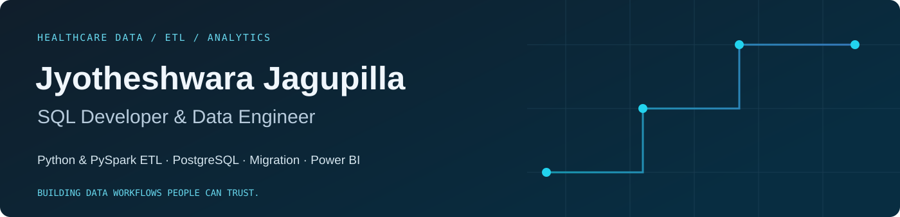

  

  <a href="https://www.linkedin.com/in/jyotheshwara-venkata-sai-kumar-jagupilla-4bb563283/">LinkedIn</a> ·
  <a href="https://github.com/Jyotheshwara?tab=repositories">Repositories</a> ·
  <a href="https://jyotheshwara.github.io/">Existing portfolio</a> ·
  <a href="https://jsounds.pages.dev/">J Sounds</a>

## About me

I'm **Jyotheshwara Venkata Sai Kumar Jagupilla**, a **SQL Developer & Data Engineer at Endava**, with professional experience since **August 2023** across healthcare claims, ETL, database development, migration, and business intelligence.

I connect **Python and PySpark data processing** with **SQL and PostgreSQL engineering**, data validation, and reporting. My work spans GxClaims healthcare workflows, cross-platform database migrations, and Power BI modernization.

Outside my core domain, I enjoy building practical productivity tools and creative web experiences, including **J-Space** and **J Sounds**. I use AI-assisted development as part of my learning and building process.

 

## What I bring

| Engineer data | Modernize databases | Deliver analytics |
| --- | --- | --- |
| Python & PySpark ETL, SQL transformations, validation and reconciliation | PostgreSQL development, Oracle / SQL Server migration, schema mapping and query tuning | Power BI dashboards, DAX, Power Query, semantic models and KPI reporting |

## Selected professional experience

### 01 · GxClaims — ETL & Healthcare Data Engineering

`Python` `PySpark` `SQL` `PostgreSQL` `Oracle`

- Developed **ETL workflows using Python and PySpark** for GxClaims healthcare claims data processing.
- Worked on data transformation and validation within claims data workflows.
- Developed database objects, stored procedures, functions, and SQL logic supporting claims validation and adjudication analysis.
- Optimized SQL used by Java backend services and supported Oracle-to-PostgreSQL migration.

### 02 · GxClaims F6 Upgrade — Database Design

`PostgreSQL` `PL/pgSQL` `JSONB` `Python` `NCPDP D.0 / F6`

- Led **template-driven PostgreSQL database design** and supported mapping between NCPDP D.0 and F6 claim structures.
- Developed adapter and validation workflows.
- Used generated columns, indexes, data reconciliation, and regression testing to support claims-processing workflows.

### 03 · Database Migration & Reconciliation

**Oracle → PostgreSQL · SQL Server → PostgreSQL · Azure SQL → BigQuery**

- Supported **GxClaims** and **GxDashMaps** migration through database-object conversion, compatibility fixes, and source-to-target validation.
- Resolved SQL dialect, data-type, and procedural-logic differences across platforms.
- Designed ELT pipelines and applied schema mapping and data modeling for Azure SQL to BigQuery migration.
- Prepared technical documentation and source-to-target mappings.

### 04 · Power BI Reporting Modernization

`Power BI Desktop & Service` `DAX` `Power Query (M)` `SSRS` `Azure DevOps`

- Developed interactive dashboards, KPI scorecards, semantic models, and reports aligned with business requirements.
- Migrated legacy **SSRS reports to Power BI**, redesigning report logic, layouts, and models.
- Managed deployments across **Development, UAT, and Production** using deployment pipelines and Azure DevOps CI/CD.
- Performed data validation and collaborated with reporting teams, clients, and business stakeholders.

### Additional hands-on work

- **Databricks healthcare analytics POC:** Unity Catalog, Delta Lake, and Bronze / Silver / Gold Medallion Architecture.
- **AWS cloud data engineering labs and POCs:** practical exploration of cloud storage, database connectivity, and data processing.
- **Python database automation:** Streamlit utilities for database operations, spreadsheet comparison, and validation.

*Professional project summaries describe my experience. Employer source code, internal schemas, and client data are not published here.*

## Beyond data engineering · Personal projects

I also build tools and creative experiences outside my day-to-day role.

### J-Space · A practical productivity workspace

**Python · Streamlit · SQL · Spreadsheet & document utilities**

A workspace bringing routine tasks together:

- **Database Studio:** PostgreSQL, MySQL, and SQLite connectivity; Excel imports; SQL previews and review before database changes.
- **Excel Compare:** compare sheets or workbooks and review matching and one-sided rows.
- **PDF to Image:** convert PDF pages to PNG/JPEG, with previews and ZIP export.
- **Grammar Checker:** LanguageTool-based grammar, spelling, and punctuation suggestions.

[Open app via LinkedIn project link](https://lnkd.in/drVv3GTR) · [Source repository — private](https://github.com/Jyotheshwara/J-Space)

### J Sounds · Music meets an interactive web experience

**React · JavaScript · Vite · Cloudflare Pages**

My personal music website, built from the **Jstudios** repository. It presents **25 compositions** with individual artwork, a puzzle entrance, search and mood filtering, favourites, track sharing, and a player with queue, shuffle, repeat, volume, and seeking controls.

This project brings together my interest in music, visual presentation, and interactive application design.

[Listen on J Sounds](https://jsounds.pages.dev/) · [Jstudios source — private](https://github.com/Jyotheshwara/Jstudios)

### Personal portfolio · My professional story on the web

**HTML · CSS · JavaScript · GitHub Pages**

My existing portfolio brings together my professional background, project summaries, education, and learning journey.

[View existing portfolio](https://jyotheshwara.github.io/) · [Public source repository](https://github.com/Jyotheshwara/Jyotheshwara.github.io)

*J-Space and Jstudios source repositories are private. Their source links require access; public visitors can use the app/site links above.*

## Technical skills

The table includes professional tools and technologies from my learning and POC work. The experience sections above show where I have applied them; proficiency varies by tool.

| Area | Technologies & practices |
| --- | --- |
| **Programming & processing** | SQL, Python, PySpark, Pandas, NumPy, PL/SQL, PL/pgSQL, T-SQL |
| **Databases** | PostgreSQL, Oracle, SQL Server, Azure SQL, MySQL, MongoDB, Snowflake; OLTP and OLAP systems |
| **ETL & data engineering** | ETL/ELT development, data pipelines, data integration, data transformation, migration, source-to-target mapping, schema mapping, data validation, reconciliation, data quality, data warehousing, data lakes, Airflow |
| **Modeling & database design** | Data modeling, dimensional modeling, star and snowflake schemas, database/schema design, stored procedures, functions, views, JSONB, generated columns, indexes, query optimization, execution-plan analysis |
| **Cloud & lakehouse** | Databricks, Delta Lake, Unity Catalog, Medallion Architecture, GCP, BigQuery, Google Cloud Storage, Dataflow, Azure SQL, AWS, AWS Glue, Amazon S3, DynamoDB, Lambda, RDS, IAM |
| **Business intelligence** | Power BI Desktop, Power BI Service, Power Query (M), DAX, semantic models, dashboards, KPI scorecards, report development, data visualization and storytelling, report performance optimization, dataset refresh monitoring, data connectivity, Power BI governance, SSRS, SSIS, Tableau, Excel |
| **Development & delivery** | Git, GitHub, Azure DevOps, CI/CD pipelines, Power BI deployment pipelines, Postman, JIRA, VS Code, pgAdmin, SSMS, Agile/Scrum, technical documentation |
| **Personal-project technologies** | Streamlit, React, JavaScript, HTML, CSS, Vite, Cloudflare Pages, GitHub Pages, LanguageTool |
| **AI-assisted development** | Microsoft Copilot, ChatGPT; assistance with SQL/DAX, documentation, test cases, and productivity workflows |
| **Collaboration** | Requirement gathering, stakeholder management, effective communication, problem solving, technical documentation |

**Learning context:** Databricks lakehouse work includes a healthcare analytics POC; AWS experience includes labs and POCs; Snowflake knowledge is foundational.

## Certifications & continuous learning

### Industry certifications

| Credential | Year |
| --- | --- |
| **Databricks Certified Data Engineer Associate** | 2026 |
| **AWS Certified Cloud Practitioner** | 2026 |

### Courses, skill credentials & learning paths

| Learning / credential | Provider | Year |
| --- | --- | --- |
| AWS Cloud Practitioner CLF-C02 course | Udemy | 2026 |
| MongoDB Database Administration / Database Admin Path (Self-Managed) | MongoDB | 2025 |
| Power BI | O'Reilly | 2025 |
| Python | Udemy | 2024 |
| SQL | HackerRank and Simplilearn | 2023 |
| Oracle Administration Workshop | Infosys Springboard | — |

*Course completions and learning paths are listed separately from industry certifications.*

## Career at a glance

| Period | Role | Organization |
| --- | --- | --- |
| **Jan 2026 – present** | Senior Developer / Data Engineer — Senior Technician | Endava Solutions India Private Ltd. |
| **Jan – Dec 2025** | Developer | Endava Solutions India Private Ltd. |
| **Aug 2023 – Dec 2024** | Associate Developer | GalaxE Solutions India Private Ltd., acquired by Endava |

## Education

**Bachelor of Technology · Electronics and Communication Engineering** 
NRI Institute of Technology, Vijayawada · **2019–2023** · **CGPA 8.9/10**

## Let's connect

I'm interested in **SQL development, ETL, data engineering, database migration, and business intelligence** — and in creative projects that turn practical ideas into useful experiences.

[Connect with me on LinkedIn](https://www.linkedin.com/in/jyotheshwara-venkata-sai-kumar-jagupilla-4bb563283/) · [Explore my repositories](https://github.com/Jyotheshwara?tab=repositories) · [Listen to J Sounds](https://jsounds.pages.dev/)
